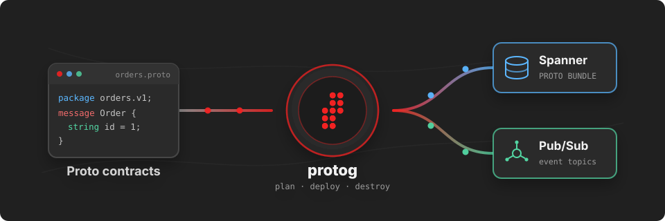

# protog

<p align="center">
  
</p>

<p align="center">
  <strong>Plan and deploy your protobuf contracts to Google Cloud.</strong>
</p>

<p align="center">
  <a href="https://github.com/alis-build/protog/tags"></a>
  <a href="https://pkg.go.dev/github.com/alis-build/protog"></a>
  <a href="LICENSE"></a>
</p>

Your `.proto` files already describe your data. `protog` treats them as the source of truth for the Google Cloud resources that depend on them. It reads a compiled `FileDescriptorSet`, compares it with what is live, shows you the plan, and applies only the difference.

Think `terraform plan` and `terraform apply`, but for **proto bundles in Spanner** and **topics in Pub/Sub**.

```text
$ protog spanner plan my-project/my-instance/my-db fds orders.v1
Parsing fds file fds
Fetching current proto bundles...
IGNORE billing.v1.Invoice
➕ CREATE orders.v1.Order
➕ CREATE orders.v1.OrderCreatedEvent
✏️ UPDATE orders.v1.OrderStatus
🗑️ DELETE orders.v1.LegacyOrder

TOTAL IGNORED: 1
TOTAL TO CREATE: 2
TOTAL TO UPDATE: 1
TOTAL TO DELETE: 1
```

## What You Get

- **Spanner proto bundles from your descriptors.** `protog` renders the exact `CREATE PROTO BUNDLE` or `ALTER PROTO BUNDLE INSERT(...) UPDATE(...) DELETE(...)` statement, uploads the descriptors with it, and follows the long-running operation to completion with progress
- **Pub/Sub topics from your events.** Every top-level message whose name ends in `Event` becomes a topic named after its fully qualified type, so `orders.v1.OrderCreatedEvent` is the topic `orders.v1.OrderCreatedEvent`
- **Plan before you deploy.** Every change is previewed as `CREATE`, `UPDATE`, `DELETE` or `IGNORE` with totals, for both forward deploys and destroys
- **Package scoping.** Name the proto packages you own and `protog` will never update or delete a type that belongs to anyone else. Nothing is ever deleted unless you name its package
- **Descriptor-aware diffs.** A type whose stored descriptor is byte-for-byte equivalent to the new one is skipped, so re-deploying an unchanged contract is a no-op rather than a full bundle rewrite
- **Terraform-style machine output.** `--json` streams NDJSON progress events on stderr and exactly one JSON result on stdout, ready for CI and for tools like the `alis` CLI to drive
- **Descriptor inspection.** `protog fds types` and `protog fds events` list what is inside any `FileDescriptorSet`, nested messages and enums included
- **Resilient credentials.** A rejected cached credential is retried once with a fresh client before the command fails

## Before You Start

You need:

- Go 1.25 or later
- `protoc` or [`buf`](https://buf.build) to compile your `.proto` files into a `FileDescriptorSet`
- Google Cloud [Application Default Credentials](https://cloud.google.com/docs/authentication/provide-credentials-adc), for example via `gcloud auth application-default login`
- Permission to read and update DDL on the target Spanner database, and to list, create and delete topics in the target project

## Install

```sh
go install github.com/alis-build/protog@latest
```

Or run it straight from a clone:

```sh
go run . --help
```

## Use It

### 1. Compile your contracts

Produce a single `FileDescriptorSet` that includes every imported file, so Spanner receives the full dependency graph.

```sh
protoc --include_imports --descriptor_set_out=fds -I=. orders/v1/*.proto
```

With `buf`:

```sh
buf build -o fds --as-file-descriptor-set
```

### 2. See what is inside

```sh
protog fds types fds
```

```text
Parsing fds file fds
orders.v1.Order
orders.v1.Order.Line
orders.v1.OrderCreatedEvent
orders.v1.OrderStatus
```

```sh
protog fds events fds
```

```text
Parsing fds file fds
orders.v1.OrderCreatedEvent
```

### 3. Spanner proto bundles

The database is addressed as `{projectID}/{instance}/{database}`. Trailing arguments are the proto packages you own.

```sh
protog spanner view   my-project/my-instance/my-db
protog spanner plan   my-project/my-instance/my-db fds orders.v1
protog spanner deploy my-project/my-instance/my-db fds orders.v1
```

A deploy prints the DDL it submits and tracks the operation until Spanner reports it done:

```text
Deploying proto bundles...
ALTER PROTO BUNDLE INSERT(`orders.v1.Order`,`orders.v1.OrderCreatedEvent`) UPDATE(`orders.v1.OrderStatus`) DELETE(`orders.v1.LegacyOrder`)
Progress: 100%
Proto bundles deployed
```

When the database has no proto bundle yet, `protog` issues `CREATE PROTO BUNDLE` instead.

### 4. Pub/Sub topics

The project is addressed by its ID. The same package scoping applies.

```sh
protog pubsub view   my-project
protog pubsub plan   my-project fds orders.v1
protog pubsub deploy my-project fds orders.v1
```

Topics are created and deleted concurrently in small batches. An existing topic is never modified, so a Pub/Sub plan only ever contains creates, deletes and ignores.

### 5. Tear a package down

Destroy takes no descriptor file. The desired state is simply "none of this package's types".

```sh
protog spanner plandestroy my-project/my-instance/my-db orders.v1
protog spanner destroy     my-project/my-instance/my-db orders.v1

protog pubsub plandestroy my-project orders.v1
protog pubsub destroy     my-project orders.v1
```

## How It Works

Every `plan`, `deploy`, `plandestroy` and `destroy` runs the same three steps: parse the descriptor set, fetch the live state, diff the two. The diff decides the fate of each fully qualified type:

| The type is…                | Without package IDs                  | With package IDs                                   |
| --------------------------- | ------------------------------------ | -------------------------------------------------- |
| in the fds, not live        | `CREATE`                             | `CREATE`, even outside your packages (imports)     |
| live and in the fds         | `UPDATE`                             | `UPDATE` if it is in a named package, else `IGNORE` |
| live, not in the fds        | `IGNORE`                             | `DELETE` if it is in a named package, else `IGNORE` |

A type belongs to a package when the package is its exact prefix and the next identifier is a type name. `orders.v1` owns `orders.v1.Order` and the nested `orders.v1.Order.Line`, but not `orders.v1.internal.Audit`, which lives in a nested package you must name separately. Naming `orders` on its own matches nothing in `orders.v1`.

For Spanner, `protog` then compares the descriptor stored in the database with the one in your fds for each `UPDATE`. Identical descriptors drop the type to `IGNORE`. If either side is missing a descriptor, the command fails rather than guess.

Deploys poll the Spanner operation every three seconds and surface its progress percentage and throttling flag. Pub/Sub deploys stop scheduling new batches after the first failed topic and report the outcome of each topic individually.

## Machine-Readable Output

Add `--json` to any command and `protog` follows the same contract as `terraform -json` and the `alis` CLI:

- **stderr** carries one NDJSON progress event per line
- **stdout** carries exactly one JSON result object, written once, even on failure

```sh
protog --json spanner plan my-project/my-instance/my-db fds orders.v1 2>events.ndjson >result.json
```

Each event has `@level`, `@message`, `@timestamp` and `type`, plus a typed payload:

| `type`             | When                                                            |
| ------------------ | --------------------------------------------------------------- |
| `version`          | First event of every run, with the `ui` schema version          |
| `fds_parsed`       | The descriptor set was read, with type or event counts          |
| `refresh_start`    | Fetching live proto bundles or topics                           |
| `refresh_complete` | Live state fetched, with the existing count                     |
| `planned_change`   | One `create`, `update`, `delete` or `noop` for a named resource |
| `change_summary`   | Totals for the plan                                             |
| `apply_start`      | A deploy began, with the DDL statement for Spanner              |
| `apply_progress`   | Spanner operation progress, percent and throttled flag          |
| `apply_complete`   | A deploy finished, with elapsed seconds                         |
| `apply_errored`    | A deploy failed, with the error                                 |
| `auth_retry`       | A cached credential was rejected and refreshed                  |
| `log`              | Free-form progress line                                         |
| `diagnostic`       | A warning or error that is not tied to a resource               |

The result object mirrors the plan:

```json
{
  "operation": "plan",
  "target": {
    "kind": "spanner_database",
    "database": "projects/my-project/instances/my-instance/databases/my-db"
  },
  "create": ["orders.v1.Order", "orders.v1.OrderCreatedEvent"],
  "update": ["orders.v1.OrderStatus"],
  "delete": ["orders.v1.LegacyOrder"],
  "ignore": ["billing.v1.Invoice"],
  "changes": { "add": 2, "change": 1, "remove": 1, "ignore": 1, "operation": "plan" },
  "statement": "ALTER PROTO BUNDLE INSERT(`orders.v1.Order`,`orders.v1.OrderCreatedEvent`) UPDATE(`orders.v1.OrderStatus`) DELETE(`orders.v1.LegacyOrder`)"
}
```

Deploy results add `success` and either the Spanner `lro` (name, done, throttled, commit timestamps) or the per-topic Pub/Sub `results`. A failed command exits with status 1 and writes `{"error":{"code":"...","message":"..."}}` to stdout, where `code` is the gRPC status in snake case, such as `permission_denied` or `not_found`.

## Command Reference

| Command                                                | What it does                                              |
| ------------------------------------------------------ | --------------------------------------------------------- |
| `protog fds types <fds>`                               | List every message and enum, nested ones included         |
| `protog fds events <fds>`                              | List top-level messages ending in `Event`                 |
| `protog spanner view <db>`                             | List the types in the database's proto bundle             |
| `protog spanner plan <db> <fds> [package...]`          | Preview proto bundle changes                              |
| `protog spanner deploy <db> <fds> [package...]`        | Apply proto bundle changes                                |
| `protog spanner plandestroy <db> <package>...`         | Preview the types a destroy would remove                  |
| `protog spanner destroy <db> <package>...`             | Remove the named packages' types                          |
| `protog pubsub view <project>`                         | List the project's topics                                 |
| `protog pubsub plan <project> <fds> [package...]`      | Preview topic changes                                     |
| `protog pubsub deploy <project> <fds> [package...]`    | Apply topic changes                                       |
| `protog pubsub plandestroy <project> <package>...`     | Preview the topics a destroy would remove                 |
| `protog pubsub destroy <project> <package>...`         | Delete the named packages' topics                         |

`<db>` is `{projectID}/{instance}/{database}`. Every command accepts `--json`, and `protog -v` prints the version.

## Development

```sh
make protoc           # rebuild test/fds from test/test.proto
go test ./...         # unit tests, no cloud access required
go run . fds types test/fds
```

`protog` is built by [Alis Build](https://alis.build) and released under the [MIT license](LICENSE).
